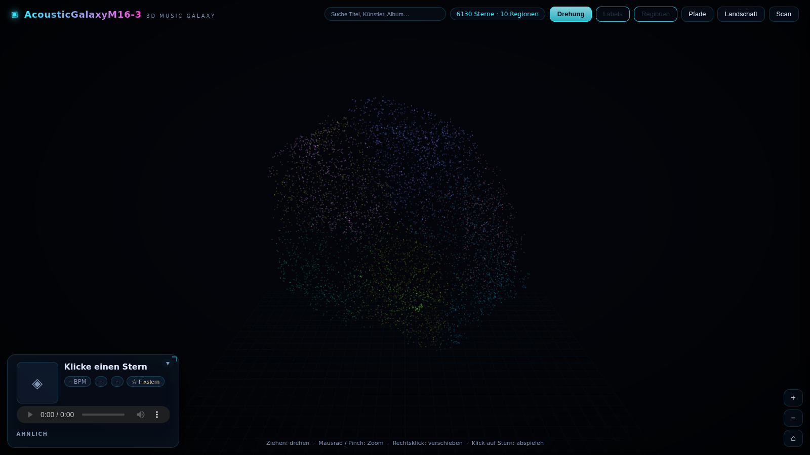

# AcousticGalaxyM16-3

Deine lokale Musikbibliothek als interaktive 3D-Galaxie: Jeder Titel wird zu einem
Stern, ähnliche Stücke ziehen sich an, und Regionen tragen die Namen ihrer
prägenden Interpreten. Gebaut mit FastAPI, librosa, UMAP und three.js.



## Funktionen

- **3D-Galaxie** aller Titel im Browser (three.js, OrbitControls)
- **Ähnlichkeitslayout** aus Audio-Features: Tempo, Tonart, Spektral-Centroid,
  RMS-Energie, Zero-Crossing-Rate und 13 MFCCs → Embedding → UMAP (Fallback: PCA)
  → KMeans-Regionen
- **Regionsnamen** aus den charakteristischen Interpreten; die angezeigten
  Repräsentanten wechseln bei jedem Reload
- **Suche** nach Titel, Interpret und Album, inklusive Ähnlichkeitssuche
- **Wiedergabe** im Browser, Cover-Anzeige, Lyrics (LRC und ungetaktet)
- **Fixsterne**: Favoriten im Browser (localStorage) werden dauerhaft hervorgehoben
- **Hintergrundberechnung** der Landschaft mit Statusanzeige (`/api/landscape`)
- **Cache** aller Analyseergebnisse, damit die Bibliothek nur einmal analysiert wird

## Voraussetzungen

- Python 3.10+
- `ffmpeg` und `libsndfile` (Dekodierung von MP3/FLAC/Ogg/M4A)
- Linux oder macOS; getestet unter Linux

## Installation

```bash
git clone https://github.com/Henrik-Aalto/AcousticGalaxyM16-3.git
cd AcousticGalaxyM16-3
python3 -m venv .venv
source .venv/bin/activate
pip install -r requirements.txt
```

Alternativ installiert `sudo python3 app.py --install-deps` die nötigen
Systempakete und Python-Abhängigkeiten (Debian/Ubuntu).

## Schnellstart

```bash
python3 app.py --init      # Musikordner und Unterordner auswählen
python3 app.py             # Server auf http://127.0.0.1:8000
```

Weitere Optionen:

| Option | Bedeutung |
| --- | --- |
| `--root PFAD` | Musikbibliothek direkt setzen |
| `--paths 1,3-5` | Unterordner-Auswahl für `--init` |
| `--yes`, `-y` | ohne Rückfragen |
| `--host`, `--port` | Bind-Adresse und Port des Servers |

Die Musik wird ausschließlich gelesen, nie verändert.

## Konfiguration

`--init` schreibt `cache/config.json`:

```json
{
  "root": "/pfad/zur/musik",
  "paths": ["Rock", "Jazz"]
}
```

Zusätzlich lassen sich Umgebungsvariablen nutzen:

| Variable | Standard |
| --- | --- |
| `ACOUSTI_MATCH_AUDIO_DIR` | `/mnt/Audio` |
| `ACOUSTI_MATCH_CACHE_DIR` | `./cache` |
| `ACOUSTI_MATCH_HOST` | `127.0.0.1` |
| `ACOUSTI_MATCH_PORT` | `8000` |

## Nextcloud-App (AppAPI)

Unter `nextcloud/` liegt eine ExApp-Variante, die die Bibliothek der
Nextcloud **Music**-App nutzt (Subsonic-API, Favoriten als Fixsterne).
Voraussetzungen, Image-Build und Registrierung stehen in
[`nextcloud/README.md`](nextcloud/README.md).

## Wie es funktioniert

1. **Scan** sammelt alle Audiodateien der gewählten Ordner.
2. **Feature-Extraktion** analysiert je Titel die ersten 60 Sekunden mit librosa.
3. **Embedding + UMAP** projizieren die Titel in einen 3D-Raum; ohne
   `umap-learn` wird PCA verwendet.
4. **KMeans** fasst benachbarte Titel zu Regionen zusammen, die nach ihren
   überrepräsentierten Interpreten benannt werden.
5. Das **Frontend** rendert Punkte, Regionen, Labels, Pfade und die Auswahl-UI.

Die Landschaft wird im Hintergrund berechnet und über `POST /api/landscape`
angestoßen; `GET /api/landscape` liefert den Status.

## API (Auswahl)

| Endpoint | Zweck |
| --- | --- |
| `GET /api/status` | Scan-/Analysefortschritt |
| `POST /api/scan` | Bibliothek neu einlesen |
| `GET /api/map` | Alle Punkte, Cluster und Regionsnamen |
| `GET /api/landscape` | Status der Landschaftsberechnung |
| `POST /api/landscape` | Landschaftsberechnung starten |
| `GET /api/similar/{id}` | Ähnliche Titel |
| `GET /api/track/{id}` | Metadaten eines Titels |
| `GET /api/cover/{id}` | Cover-Bild |
| `GET /api/lyrics/{id}` | Lyrics (synchronisiert und Text) |
| `GET /api/audio/{id}` | Audiodatei zum Abspielen |
| `GET /api/paths`, `POST /api/root`, `POST /api/selection` | Ordnerverwaltung |

## Projektstruktur

```text
app.py               FastAPI-Backend, Analyse und Landschaft
requirements.txt     Python-Abhängigkeiten
static/
  index.html         UI
  app.js             three.js-Galaxie und Interaktion
  style.css          Styling
  vendor/            three.js und OrbitControls (MIT)
docs/galaxy.png      Screenshot der Galaxie
version.sh           erstellt Quellcode-Snapshots unter versions/
nextcloud/           ExApp-Variante für die Nextcloud Music-App
cache/               Analyse-Cache (nicht im Repo)
```

## Hinweise

- Die erste Analyse einer großen Bibliothek dauert einige Minuten; danach greift
  der Cache in `cache/database.json`.
- Favoriten („Fixsterne“) liegen in der Standalone-Version im Browser; die
  Nextcloud-Variante speichert sie in der Music-App.
- `versions/` und `cache/` sind per `.gitignore` ausgeschlossen.

## Lizenz

MIT – siehe [LICENSE](LICENSE). Die eingebundenen Dateien in `static/vendor/`
(three.js, OrbitControls) stehen ebenfalls unter der MIT-Lizenz.
